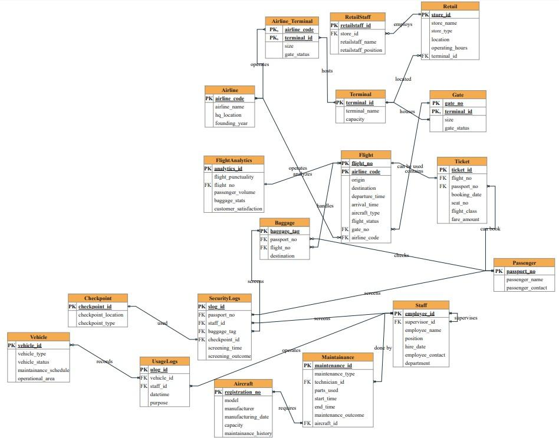

# Airport & Food-Delivery Database Design

Two team assignments from **AML 2503 – SQL & NoSQL Database Design** at Lambton College (Winter 2026): a relational design for an **airport management system**, and a document-database design for **FoodFleet**, a food-delivery platform, implemented in MongoDB Atlas.

**Team:** Group 2 (4 members)

## Part 1 — Airport Management System (relational)

- **ER diagram** covering staff, terminals, gates, airlines, flights, aircraft maintenance, passengers, tickets, baggage, security screening, retail stores and ground vehicles
- **Every relationship described in both directions**, for example *Airline operates Flight* and *Flight is operated by Airline*
- **Data dictionary for 17 tables**: each field's data type, primary and foreign keys, and meaning — including composite keys such as Flight (`flight_no`, `airline_code`) and Gate (`gate_no`, `terminal_id`)



## Part 2 — FoodFleet NoSQL design (MongoDB Atlas)

- **Why NoSQL:** restaurant menus, customizable meals, mixed-restaurant carts and fast-growing delivery logs are nested and change often, which a rigid relational schema handles poorly
- **Why a document database:** we compared document (MongoDB) and graph (Neo4j) models and chose MongoDB Atlas as the primary store, keeping a graph database as an option for future recommendations
- **6 collections** with JSON-style schemas: `users`, `restaurants`, `orders`, `drivers`, `order_logs` and `notifications`
- **Hybrid embedding and referencing:** data that is read together is embedded; fast-growing or independently changing data is referenced
- **10 queries plus CRUD operations** in mongosh syntax, using filters, projections, sorting and a `$group` aggregation — see [`foodfleet_queries.js`](foodfleet_queries.js)

| Collection | Holds | Design choice |
| --- | --- | --- |
| `users` | profiles, addresses, dietary preferences, payment methods | addresses and payment methods embedded; order history referenced |
| `restaurants` | contact details, opening hours, menus and customizable items | menus and items embedded |
| `orders` | cart contents, group-order splits, totals and status | cart items and splits embedded; user, driver, restaurants and logs referenced |
| `drivers` | status, live location, assigned deliveries | deliveries referenced |
| `order_logs` | status updates with timestamps and GPS points | own collection, because logs grow without limit |
| `notifications` | order updates and promotions | references the related order |

## Documents

- [Assignment 1 – Airport Management System (PDF)](assignment1_airport_management_system.pdf): ER diagrams, relationships and data dictionary
- [Assignment 2 – FoodFleet NoSQL Database Design (PDF)](assignment2_foodfleet_nosql_design.pdf): NoSQL justification, collection schemas, queries and CRUD

Team member names, student IDs and a private notebook link were removed from these public copies.

## Repository structure

```
airport-food-delivery-database-design/
├── README.md
├── airport_er_diagram.jpg                      # detailed ER diagram from Assignment 1
├── assignment1_airport_management_system.pdf
├── assignment2_foodfleet_nosql_design.pdf
└── foodfleet_queries.js                        # 10 MongoDB queries + CRUD operations
```
